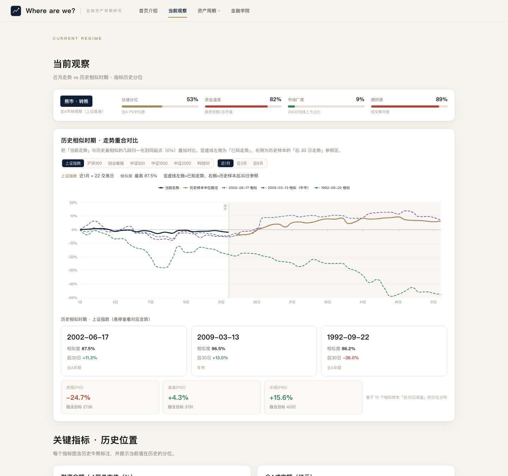

# Where are we? · 大类金融资产周期复盘

[](https://github.com/saviorbill/asset-cycle-atlas/actions/workflows/ci.yml)
[](https://github.com/saviorbill/asset-cycle-atlas/actions/workflows/pages.yml)
[](LICENSE)

用同一套框架（周期定位 → 驱动及反转 → 指标监测 → 当前映射）回答一个问题：**现在，各类金融资产走到了周期的哪一步？**

> 当前已实现 **A股**（7 大指数 K 线、牛熊阶段、国家队资金流、指标分位）；**债券 / 商品 / 其他资产** 已在导航中预留，规划中。

前端是纯静态网站（HTML + 原生 JS + ECharts），后端是 Python 数据管道，**不需要 Node、不需要打包**。



> 首页介绍 · 当前观察 · 资产周期 · 金融学院 四大模块；A股已上线，涵盖 7 大指数 K 线、牛熊阶段高亮、国家队资金流、状态打分、指标分位。

---

## 快速开始（克隆后）

**只看网站**（无需 Python）：
```bash
# 双击打开，或用任意静态服务器
open web/index.html
```

**跑数据管道**（可选）：
```bash
pip install -r requirements.txt
export DATAHUB_API_KEY=你的_key        # 在线增量更新需要（datahubco tushare 网关）
cd src && python3 build_web_data.py    # 重新生成 web/data.js
```

---

## 一、用 VSCode 打开

1. VSCode → `File > Open Folder…` → 选 `ashare-fupan` 目录
2. 建议装两个扩展：
   - **Live Server**（右键 `web/index.html` → Open with Live Server，热刷新，推荐）
   - **Python**（跑数据脚本用）
3. 选解释器：`⌘⇧P` → `Python: Select Interpreter` → 选 `/usr/bin/python3`（系统 Python 3.9，已装 pandas/pyarrow/openpyxl）

---

## 二、目录结构（重点看前两个）

```
ashare-fupan/
├── web/                       ★ 前端（改界面就改这里）
│   ├── index.html             页面骨架 + 顶部导航 + 各视图
│   ├── style.css              全部样式（配色/字体/卡片/工具栏）
│   ├── app.js                 全部交互逻辑（图表渲染 / 导航 / 状态打分）
│   ├── data.js                【自动生成】所有数据，window.WAW = {...}
│   └── echarts.min.js         ECharts 库（本地，勿动）
│
├── src/                       ★ 数据管道（改数据/指标就改这里）
│   ├── build_web_data.py      主数据生成器 → 输出 web/data.js
│   ├── build_state_score.py   状态打分（各维分位 + 8 指数同档分布）→ 输出 web/state_score.js
│   ├── build_fundamentals.py  个股财务聚合成指数/行业季度序列 → 应用数据/cache/fund_panel.parquet
│   ├── build_hist_stats.py    历史统计（技术/基本面/情绪三维，指数+31板块）→ 输出 web/hist_stats.js
│   ├── fetch_sw_missing.py    补拉申万行业（煤炭/石油石化/环保/美容护理）
│   ├── build_iv_index.py      A股版 VIX：50ETF/300ETF 期权反解 30 天隐含波动率 → 应用数据/cache/iv_index.parquet
│   ├── build_models_extra.py  排名/生存/转移/变点/风险/贝叶斯/集成 → 输出 web/models_extra.js
│   ├── build_ml_model.py      机器学习机制（熊市阶段 → 未来 10–60 日收益分位；指数 + 申万一级板块）→ 输出 web/ml_model.js
│   ├── log_recommendation.py  把当日建议原样记进台账（只追加）→ A股数据/validation/
│   ├── score_recommendations.py 给台账算到期结果 → web/validation.js
│   ├── build_conclusion.py    综合建议（规则 + 模型合成）→ 输出 web/conclusion.js
│   ├── build_nsf.py           国家队 ETF 净申购（份额口径）→ 应用数据/cache/nsf_flow.csv
│   ├── update_cyq.py          筹码分布 cyq_perf 增量更新（获利比例维度，易停更）
│   ├── update_tushare.py      Tushare 增量更新（全量分片：指数/估值/两融/涨跌停/面板）
│   ├── update_akshare.py      akshare 增量更新（token 到期后的替代方案，分片格式一致）
│   ├── fetch_ml_extra.py      补齐 ML 用的额外数据（期权/期货/成分权重/申万/两融明细等）
│   ├── update_indicators.py   增量更新指标到最新（抓 datahubco API）
│   ├── build_market_agg.py    全A面板 → 应用数据/cache/market_daily.parquet（2016 起）
│   ├── build_market_agg_pre2016.py  用「前复权」逐股 CSV 重建 2005–2015 结构指标
│   ├── build_industry.py      行业/主题聚合 → 应用数据/cache/theme_daily.parquet
│   ├── config.py              路径 + 阈值 + 牛熊周期定义
│   ├── cycle_events.py        牛熊事件/政策事件（改事件标注改这里；状态打分读它的 POLICY_EVENTS）
│   ├── cycle.py               牛熊峰谷分段（ZigZag）
│   ├── clock.py / scoring.py / sentiment.py / narrative.py   其他分析模块
│   └── fetch_api_data.py      IPO/减持等月度数据抓取
│
├── docs/                      设计文档、宏观相关性分析、机器学习可行性评估、流动性筹码情绪研究框架
├── notes/                     研报笔记
├── run.py                     一键重算：聚合 → 行业 → 网页数据 → 国家队 → 打分卡 → 机器学习 → 综合建议
└── README.md                  本文件
```

> **数据源全部在项目外**：`/Users/kunrongcai/Desktop/A股数据/`。
> 本项目自己的输入与缓存放在它的 `应用数据/` 子目录（`index_daily.csv`、`index_kline/`、
> `policy_events.csv`、`cache/`），路径统一由 `src/config.py` 管理。
> **总目录见 `A股数据/数据地图.md`。**

---

## 三、三种日常工作流

### ① 只改界面（最快，不用跑 Python）
改 `web/index.html`、`web/style.css`、`web/app.js` → 用 Live Server 或直接双击 `web/index.html` 看效果。
- 改标题/文案 → `index.html`
- 改配色/字体/间距 → `style.css` 顶部 `:root` 变量（`--navy` `--gold` `--bg` `--serif` 等）
- 改图表逻辑/交互 → `app.js`（各 `renderXxx()` 函数）

### ② 改了指标/周期/事件后重新生成数据
```bash
cd src
/usr/bin/python3 build_web_data.py      # 最常用：只重算 web/data.js（几秒）
# 如果改了面板聚合逻辑才需要：
/usr/bin/python3 build_market_agg.py    # 较慢，几分钟
/usr/bin/python3 build_industry.py
```
或一键（全部重算，较慢）：
```bash
/usr/bin/python3 run.py
```

### ③ 把数据更新到最新日期

**Tushare Pro（推荐；本机 token 到 2026-12-18 失效）**
```bash
source ~/.ashare_env                        # 里面是 TUSHARE_TOKEN
/usr/bin/python3 src/update_tushare.py all  # 指数/估值/两融/涨跌停/股票列表/个股面板
/usr/bin/python3 src/update_tushare.py downstream
/usr/bin/python3 src/update_cyq.py       # 筹码分布（状态打分的"获利比例"维度，独立于上面两步）
/usr/bin/python3 src/fetch_ml_extra.py fund_share   # 基金份额（国家队维度原料，需先跑这个再跑 build_nsf.py）
```

**akshare（token 到期后，无需任何 key）**
```bash
/usr/bin/python3 src/update_akshare.py all  # 指数/估值/两融/涨跌停/股票列表/个股面板
/usr/bin/python3 src/update_akshare.py downstream
```

两者写出的分片格式完全一致，可以混用：历史数据用 Tushare 一次性补齐，
之后每天用 akshare 追加，`build_panel()` 统一重建前复权面板。

| 数据 | akshare 来源 | 说明 |
|---|---|---|
| 个股日线 | 东财 `stock_zh_a_hist`，失败自动切新浪 `stock_zh_a_daily` | 均为不复权；5,126 只约 5–12 分钟 |
| 复权因子 | 新浪 `qfq-factor` | 缩放到 Tushare adj_factor 同一量纲 |
| 市值/股本 | 东财 `stock_zh_a_spot_em` | 每日校正增发/回购；东财不可达时用持仓股本 |
| 指数日线 | 东财 `index_zh_a_hist` | 8 个指数 |
| 两融 | `stock_margin_sse/szse` | 深市原始单位亿元，已换算；约 19:00 后发布 |
| 涨跌停 | `stock_zt_pool_em` / `_dtgc_em` | 与 Tushare 家数一致 |
| 指数估值 | 无日频公开源 | `valuation` 模式按指数涨跌推算，CSV 标记 `ak-proj`，网页标注「起为价格推算」 |

与 Tushare 同日对比（2026-11-18 全池 5,126 只）：收盘价、成交量**完全一致**；
复权因子 5,119 只中 5,113 只完全一致（6 只差 ≤1.7%）；PE 中位误差 6e-7；
总市值 p99 误差 6e-7。差异集中在当日有增发/回购的个别股票，靠东财快照校正，
东财不可达时会保留上一日股本（偏差 1–6%）。

> 两家接口都会偶发整站不可达（尤其东财在连续抓几千只后会限流）。脚本开跑前
> 各试一次、失败就整轮熔断切到另一家，所有 HTTP 请求统一 20 秒超时
> （`AK_HTTP_TIMEOUT` 可调），不会再像早先那样挂在 SYN_SENT 上不动。

### ③.5 补 ML 用的额外数据（Tushare 独有，akshare 补不了历史）

```bash
/usr/bin/python3 src/fetch_ml_extra.py all      # 按价值顺序全部补齐，约 3–4 小时
/usr/bin/python3 src/fetch_ml_extra.py check    # 看已落盘情况
```

落盘在 `/Users/kunrongcai/Desktop/A股数据/ml_data/<数据集>/<数据集>_<年份>.parquet`，
断点续传：删掉某年的文件就会重抓那一年。

| 数据集 | 起点 | 规模 | 用途 |
|---|---|---|---|
| `opt_daily` / `opt_basic` | 2015-02-09 | ~500 万行 | 隐含波动率、skew、期限结构 —— 市场自己给出的概率分布 |
| `fut_daily` / `fut_basic` | 2010-04-16 | ~26 万行 | IF/IC/IH/IM 基差、贴水率、期限结构、持仓 |
| `index_weight` | 2008-01 | ~7 万行 | 逐月成分权重，做 point-in-time 广度，消除生存偏差 |
| `sw_daily` / `index_classify` / `index_member` | 2008-01 | ~30 万行 | 申万行业轮动、行业离散度 |
| `margin_detail` | 2010-04-01 | ~1,800 万行 | 个股融资余额、买入额占比、融券余额 |
| `fx_daily` / `us_tycr` / `index_global` | 2009-01 | ~10 万行 | 日频外部驱动（汇率、美债、全球指数） |
| `fund_share` | 2016-01 | ~450 万行 | ETF 份额申赎 |
| `suspend_d` / `namechange` / `share_float` / `repurchase` / `stk_holdertrade` / `dividend` / `pledge_stat` | 2008-01 | 事件型 | 停复牌、ST 历史、解禁、回购、增减持、分红、质押 |

> 注意：`moneyflow_hsgt` 和 `hk_hold`（北向资金）在当前网关上**已下线**，
> 现有 `alt_hk_hold_tushare.csv` 停更在 2026-11-14；只有 `hsgt_top10` 可用。
> `fut_mapping` 单次上限 5,000 行会悄悄截断，已改用 `fut_daily` 里自带的
> `IF.CFX` 主力连续与 `IFL/IFL1/IFL2/IFL3` 期限结构序列。

> ⚠️ 接口必须设 `NO_PROXY='*'`（脚本里已写好），否则被代理拦。
> 前复权面板锚定最新 `adj_factor`：只要区间内有分红送转，就必须整表重建，
> 不能把未复权收盘价直接接在尾部。
> PE/PB 用最后一次 Tushare 的每股盈利/净资产随价格推算：静态 PE 在两次年报
> 之间只随市值变动，逐日推算与官方值一致；年报季（4 月）后建议重新拉一次
> 基本面系。指数估值的推算段在网页标题里会注明。

---

## 四、常见修改对照表

| 想改什么 | 改哪个文件 |
|---|---|
| 标题 / 导航文案 / 首页内容 | `web/index.html` |
| 配色、字体、卡片样式、工具栏 | `web/style.css`（顶部 `:root` 变量） |
| 标题宋体缺字 / 字形不齐 | `web/fonts/noto-serif-sc.woff2` —— 自托管子集，覆盖 GB2312 全部汉字；缺字会掉回系统宋体、笔画粗细对不上 |
| K线/资金流图/状态打分的渲染逻辑 | `web/app.js` 里对应 `renderHistory / renderNsf / renderStateScore` |
| 牛熊周期分段 | `src/build_web_data.py` 的 `INDEX_CYCLES` |
| 政策/牛熊事件标注 | `src/cycle_events.py` 的 `POLICY_EVENTS` |
| 指标列表（"关键指标"） | `web/app.js` 的 `INDS` 数组 |
| 指标计算方式 | `src/build_market_agg.py`（市场类）/ `src/build_web_data.py` |
| K线数据来源 | `src/build_web_data.py` 的 `load_kline()` + `KLINE_FILES` |
| 国家队 ETF 篮子 | `src/build_nsf.py` 的 `BASKET` / `WINDOW` |
| 状态打分的维度/阈值 | `src/build_state_score.py`（`IDX_DESC` / `BUCKET` / 市场维度 `spec`） |
| 综合建议的规则/文案 | `src/build_conclusion.py`（牛熊阈值 `THR`、最少熊市天数 `MIN_BEAR`、反弹阈值 `RALLY`、合成分权重 0.65/0.35、分界 60/52） |
| 机器学习机制 | `src/build_ml_model.py`（`HORIZONS` / `QS` / `FEATS` / 先验常数 `PRIOR_DUR`、`PRIOR_DEP`）；板块来自 `ml_data/sw_daily` |
| 数据文件在哪 | `A股数据/数据地图.md`；项目路径统一在 `src/config.py` |

---

## 五、几个关键点（避免踩坑）

1. **`web/data.js` 是生成物**，不要手改——改完会被下次 `build_web_data.py` 覆盖。要改数据就改 `src/` 里的脚本再重跑。
2. **页面直接双击 `web/index.html` 就能开**（数据用 `<script>` 加载，file:// 可用）；但推荐 Live Server，改完自动刷新。
3. **K线 Excel 在 `A股数据/应用数据/index_kline/`**：`K线导出_000001_日线数据.xlsx` 等 7 个文件。`load_kline()` 读它们 + 腾讯接口补最新几天；文件缺失时会用 `index_daily.csv` 收盘价兜底。
4. **API Key 不写在代码里**：通过环境变量 `DATAHUB_API_KEY` 提供（`src/fetch_api_data.py` / `src/update_indicators.py` 读取）。开源时切勿提交真实 Key。
5. **图表尺寸**：每个图表容器 `<div class="chart" id="...">` 的高度在 CSS 里定义（`.chart` / `.chart.mid`），"全部"对比图会动态设高度。
6. **改完 app.js 建议先跑一下语法检查**（VSCode 会标红），页面按 `⌘⇧R` 刷新看控制台报错。

---

## 六、页面结构速览（5 个视图）

| 视图 | 内容 |
|---|---|
| 首页介绍 | Hero + 资产选择（股/债/商品/其他）+ 研究框架四支柱 |
| 当前观察 | 综合建议 + 历史统计（技术9/基本面8/情绪3–5，可展开，含模型排名）/ 机器学习 + 国家队资金流（5 指数可切换）+ 模型面板 + 关键指标（2005 起） |
| 资产周期 → A股 | 历史复盘：7 指数 K 线（日/周/月）、牛熊阶段高亮、成交额、事件标注 |
| 宏观环境 | 24 项宏观指标 + 与牛熊相关性 |
| 金融学院 | 占位（可做成方法论/指标字典） |

---

## 七、环境与数据源

- Python：`/usr/bin/python3`（pandas / numpy / pyarrow / openpyxl / PIL 已装）
- 本地数据：`/Users/kunrongcai/Desktop/A股数据/`
- 在线增量：`datahubco.com` tushare 网关（`update_indicators.py`）
- 行情兜底：腾讯 `web.ifzq.gtimg.cn`（`_fetch_tencent_tail`）

---

## 许可证

[MIT](LICENSE)

## 免责声明

本项目仅用于**研究与学习**，所有内容（含历史数据、指标、相似度、情景矩阵）**不构成任何投资建议**。
历史规律不代表未来，市场有风险，决策请独立判断。

---

## 路线图

- [x] **A股**：7 大指数 K 线（日/周/月）、牛熊阶段划分与高亮、成交额、事件标注
- [x] 国家队 ETF 净申购（份额口径，与指数双栏对照）
- [x] 状态打分（7 维分位并列 + 历史同档 30/60 日分布，不合成总分）
- [ ] ~~历史相似期类比~~ —— 经检验无预测力，已下线（保留 `应用数据/policy_events.csv` 等其余能力）
- [x] 指标监测（PE/PB/融资/成交/集中度/200MA广度/新高新低/外资/IPO/减持）
- [x] 宏观环境（24 项宏观指标 + 与牛熊相关性）
- [ ] **债券**：国债收益率曲线、信用利差、股债性价比（ERP）
- [ ] **商品**：南华商品指数、CRB、金银铜油
- [ ] **其他**：汇率、REITs、另类资产
- [ ] 金融学院：方法论与指标字典
